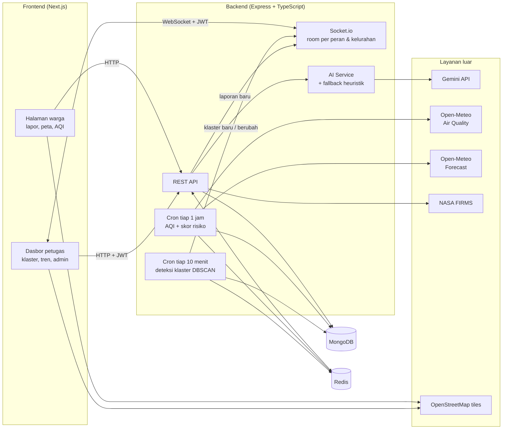
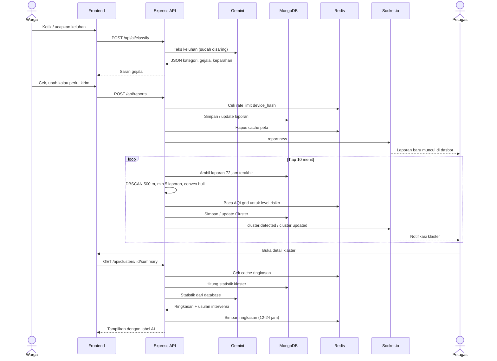

# RespiraWatch

**Warga lapor gejala. Peta langsung menunjukkan di mana klaster mulai terbentuk.**

Tahun ini lebih dari 14 juta orang di Indonesia kena ISPA. Masalahnya, data kasus biasanya baru terkumpul seminggu sekali dari Puskesmas dan rumah sakit. Waktu lonjakannya ketahuan, satu kelurahan sudah keburu ramai yang sakit.

RespiraWatch memotong jeda itu. Warga mengirim laporan gejala ISPA atau diare dari HP, tanpa daftar akun. Laporan itu digabung dengan data kualitas udara dari Open-Meteo. Setiap 10 menit, sistem mengecek apakah ada laporan yang mengumpul di satu area. Kalau ada, area itu ditandai di peta lengkap dengan level risikonya, jadi petugas tahu harus turun ke mana dulu.

- Demo live: ``
- API: ``
- Video demo: ``

<!-- tambah dokumentasi!!!  -->

---

## Daftar Isi

1. [Tim](#tim)
2. [Tentang Aplikasi](#tentang-aplikasi)
3. [Fitur yang Sudah Jalan](#fitur-yang-sudah-jalan)
4. [Teknologi](#teknologi)
5. [Arsitektur dan Alur Data](#arsitektur-dan-alur-data)
6. [Struktur Repo](#struktur-repo)
7. [Instalasi dan Menjalankan Aplikasi](#instalasi-dan-menjalankan-aplikasi)
8. [Variabel Lingkungan](#variabel-lingkungan)
9. [Akun Demo](#akun-demo)
10. [Daftar Endpoint API](#daftar-endpoint-api)
11. [Penggunaan AI](#penggunaan-ai)
12. [Atribusi](#atribusi)

---

## Tim

**Nama tim:** Kalau menang kita joget brazil di panggung

| Nama | Peran |
| --- | --- |
| Carmen Jessalyn Tjong Malik | Team Lead & Technical Documentation |
| Leticia Michelle Purba | UI/UX Designer |
| Jessica Winola | Front-End Developer |
| Kaming | Back-End Developer |

---

## Tentang Aplikasi

Kategori: Web

Nama Aplikasi: RespiraWatch

Tema: NextGen Digital Innovation: Crafting Creative Solutions for a Better Society

Track: Inclusive Health and Well-being


### Masalah yang di angkat

Data Kementerian Kesehatan per pertengahan Oktober 2026 mengungkap salah satu data penting yaitu sebanyak **14.088.948 jiwa terpapar ISPA***. Krisis ini kian bereskalasi akibat kabut asap karhutla yang menyumbang **401.586 kasus tambahan di 63 kabupaten/kota** hanya dalam waktu kurang dari tiga minggu (per 2 November).

Sayangnya, statistik resmi tersebut memiliki keterbatasan akibat fenomena _undercounting_ (kasus yang tidak tercatat). Realitas di lapangan menunjukkan tingginya jumlah kasus ISPA yang luput dari pemantauan fasilitas kesehatan formal. Masyarakat yang merawat anggota keluarganya di rumah karena menganggapnya "sekadar flu biasa", atau warga di area dengan akses kesehatan terbatas, pada akhirnya tidak terinklusi dalam data nasional. Akibatnya, terdapat _blind spot_ (titik buta) yang signifikan dalam pemetaan krisis ini.

Lebih jauh, mitigasi kesehatan kita saat ini terhambat oleh **fragmentasi data (data silos)**. Data klinis pasien dan metrik kualitas udara berada di ekosistem yang terisolasi. Untuk melacak apakah lonjakan kasus pernapasan di suatu RW berkorelasi dengan perburukan kualitas udara, petugas kesehatan harus memvalidasinya secara manual. Proses ini lambat, tidak efisien, dan menunda respons mitigasi yang seharusnya bisa dilakukan lebih awal.


### Solusi kami
Untuk memutus rantai keterlambatan deteksi tersebut, kami menghadirkan RespiraWatch dengan pendekatan teknologi berikut:
1. Pelaporan Instan & Privacy-First: Sistem memungkinkan siapa pun melapor tanpa perlu login dengan sekadar memasukkan gejala, jumlah penderita, dan lokasi. Laporan langsung masuk ke peta publik dengan pengacakan koordinat otomatis (fuzzing) 100-200 meter untuk menjamin anonimitas privasi pelapor.
2. Integrasi Parameter Udara Otonom: Secara real-time di belakang layar, server menarik metrik udara esensial (PM2.5, PM10, dan AQI) dari Open-Meteo setiap jam tanpa memerlukan intervensi manual.
3. Pemetaan Klaster Berbasis Algoritma: Setiap 10 menit, algoritma DBSCAN bekerja memindai anomali dari laporan dalam 72 jam terakhir. Area dengan minimal 5 laporan dalam radius 500 meter akan otomatis divisualisasikan sebagai klaster.
4. Penilaian Risiko Multivariabel: Tingkat bahaya dari sebuah klaster dikalkulasi secara dinamis berdasarkan akumulasi jumlah laporan, rasio jumlah penderita, dan silang-data dengan kualitas udara lokal di sekitarnya.
5. Radar Peringatan Dini (Early Warning System): RespiraWatch bukanlah alat diagnosis klinis, melainkan penyedia sinyal awal spasial. Keputusan medis tetap di tangan tenaga kesehatan, namun kini mereka dipersenjatai dengan data yang jauh lebih cepat, komprehensif, dan tepat sasaran.

### Siapa yang memakai

| Pengguna | Akses | Yang bisa dilakukan |
| --- | --- | --- |
| Warga | Tanpa login | Melapor, melihat peta publik, mengecek AQI di sekitar rumah |
| Petugas lapangan (`field_officer`) | Login | Memantau klaster real-time, membaca ringkasan AI, mengubah status klaster, mengekspor data |
| Analis kesehatan (`health_analyst`) | Login | Sama seperti petugas lapangan, ditambah melihat tren AQI dan skor risiko |
| Admin (`admin`) | Login | Semua akses di atas, ditambah mengatur data kelurahan, akun petugas, dan wilayah tugas |

---

## Fitur yang telah berjalan
### Untuk warga

- [] **Lapor tanpa akun.** Pilih kategori ISPA atau diare, centang gejala lewat ikon bergambar (batuk, demam, pilek, sesak, BAB cair, muntah), isi jumlah orang sakit dan kelompok usia.
- [] **Lapor dengan cerita (AI).** Ketik keluhan bebas seperti "anak batuk 3 hari, napasnya bunyi". Gemini membaca teksnya lalu menyarankan kategori, gejala, dan tingkat keparahan. Warga tinggal pakai sarannya atau mengubahnya dulu.
- [] **Input suara.** Keluhan bisa diucapkan lewat Web Speech API dalam bahasa Indonesia.
- [] **Pilih lokasi di peta.** Lokasi diambil dari GPS, atau ditandai manual di peta kalau GPS ditolak.
- [] **Halaman konfirmasi** sebelum laporan dikirim, lalu halaman sukses setelahnya.
- [] **Peta publik.** Heatmap laporan, lapisan AQI per grid, area klaster, skor risiko area, titik api karhutla dari NASA FIRMS, filter, dan legenda. Titik laporan selalu digeser 100-200 m demi privasi.
- [] **Kartu AQI.** Menampilkan AQI terdekat, status area, dan saran aktivitas.

### Untuk petugas

- [] **Login petugas** dengan JWT dan pembagian akses per peran.
- [] **Dasbor real-time.** Laporan dan klaster baru langsung masuk lewat Socket.io tanpa perlu refresh. Ada indikator status koneksinya juga.
- [] **Detail klaster.** Jumlah laporan, radius, lokasi, waktu, dan data cuaca setempat.
- [] **Ringkasan klaster dari AI.** Isinya judul, ringkasan situasi, hubungan dengan kondisi lingkungan, usulan intervensi lapangan, dan catatan urgensi.
- [] **Ubah status klaster:** Aktif, Dipantau, atau Selesai.
- [] **Ekspor CSV** laporan 72 jam terakhir dari dasbor, plus ekspor CSV per klaster lewat API.
- [] **Halaman tren** kualitas udara.
- [] **Halaman laporan masuk** untuk meninjau laporan warga.
- [] **Kelola data** (khusus admin): akun petugas, data kelurahan, dan penugasan wilayah.

### Di belakang layar

- [] **Anti-spam per perangkat.** Satu perangkat cuma bisa melapor sekali per jam. Laporan berikutnya dari perangkat yang sama akan memperbarui laporan lama, jadi tidak ada data dobel.
- [] **Sinkron AQI otomatis** tiap jam untuk PM2.5, PM10, US AQI, European AQI, CO, NO2, SO2, dan O3.
- [] **Skor risiko area 0-100** yang dihitung ulang tiap jam dari laporan, AQI, dan cuaca.
- [] **Deteksi klaster otomatis** tiap 10 menit dengan DBSCAN. ISPA dan diare dihitung terpisah karena penyebab dan penanganannya berbeda.
- [] **Cache Redis** untuk peta publik, AQI, skor risiko, hotspot, dan ringkasan AI, supaya aplikasi tetap cepat walaupun yang mengakses banyak.
- [] **Tetap jalan walau layanan luar bermasalah.** Kalau Gemini error atau API key-nya kosong, klasifikasi beralih ke kamus gejala dan ringkasan beralih ke template berbasis data. Kalau Redis mati, server tetap hidup tanpa cache.

---


## Teknologi

| Lapisan | Yang dipakai |
| --- | --- |
| Frontend | Next.js 16 (App Router), React 19, TypeScript, Tailwind CSS 4 |
| Peta | Leaflet, react-leaflet, leaflet.heat, tile OpenStreetMap |
| UI dan HTTP | lucide-react (ikon), axios |
| Real-time | Socket.io (server dan client) |
| Backend | Node.js, Express 5, TypeScript (ESM), `tsx` |
| Database | MongoDB + Mongoose, indeks geospasial `2dsphere` |
| Cache dan rate limit | Redis (`ioredis`), `express-rate-limit`, `rate-limit-redis` |
| Hitungan spasial | Turf.js (`@turf/clusters-dbscan`, `@turf/convex`, `@turf/helpers`) |
| Job terjadwal | `node-cron` |
| Autentikasi | JWT (`jose`), `bcryptjs` untuk hash password |
| AI | Google Gemini API (REST `generateContent`, output JSON terstruktur) |
| API pihak ketiga | Open-Meteo Air Quality API, Open-Meteo Forecast API, NASA FIRMS, Web Speech API (browser) |
| Package manager | pnpm |
| Dokumentasi API | Bruno / OpenCollection (folder `respirawatch-api-documentation`) |

---

## Arsitektur dan Alur Data

### Arsitektur sistem



### Alur data


---

Data warga dan data lingkungan masuk lewat jalur yang berbeda, lalu bertemu di MongoDB. Cron job yang menyatukan keduanya, Socket.io yang mengantarkan hasilnya ke petugas. Redis menjaga semuanya tetap cepat.

### Kapan klaster naik level

| Level | Syaratnya (cukup salah satu) |
| --- | --- |
| Prioritas (merah) | 15 laporan atau lebih, 10+ laporan dengan AQI di atas 150, ISPA 8+ laporan dengan AQI di atas 200, atau 25+ orang sakit |
| Siaga (oranye) | 8 laporan atau lebih, 5+ laporan dengan AQI di atas 100, atau 12+ orang sakit |
| Waspada (kuning) | Klaster sudah terbentuk, tapi belum memenuhi syarat di atas |

AQI ikut dihitung karena laporan batuk di area berasap jauh lebih mengkhawatirkan ketimbang laporan yang sama di area dengan udara bersih.

### Skor risiko area

Setiap sel grid dapat skor 0-100 dengan rumus:

```text
Skor = 0.5 × skor laporan + 0.3 × skor AQI + 0.2 × skor cuaca
```

Skor laporan dihitung dari jumlah laporan 72 jam terakhir dalam radius 1,5 km, lalu ditambah bobot keparahan. Skor cuaca naik saat angin tenang (polusi tertahan), kelembapan tinggi, dan suhu ekstrem. Bobot ini kami tentukan sendiri sebagai heuristik, belum divalidasi secara klinis.

Penjelasan teknis per alur ada di folder `respirawatch-api-documentation/` (file `ALUR_1` sampai `ALUR_6`).

---

## Struktur Repo

```text
respira-watch/
├── backend/                         # Express + TypeScript API
│   ├── src/
│   │   ├── index.ts                 # Entry point: HTTP server, DB, Redis, Socket.io, cron
│   │   ├── routes.ts                # Daftar semua route
│   │   ├── config/                  # MongoDB, Redis, Socket.io
│   │   ├── models/                  # Skema Mongoose (GeoJSON, 2dsphere)
│   │   ├── controllers/             # Handler HTTP
│   │   ├── services/                # Laporan, AQI, klaster, AI, analitik, auth
│   │   ├── middlewares/             # JWT, RBAC, rate limit
│   │   ├── jobs/                    # aqiCron.ts, clusterCron.ts
│   │   ├── sockets/                 # Broadcast event real-time
│   │   ├── seeders/                 # masterSeeder.ts, officerSeeder.ts
│   │   └── utils/
│   └── .env.example
├── frontend/                        # Next.js
│   ├── src/
│   │   ├── app/
│   │   │   ├── (citizen)/           # Beranda, lapor, konfirmasi, peta, profil
│   │   │   ├── dashboard/           # Dasbor, klaster, laporan, tren, admin, profil
│   │   │   └── login/
│   │   ├── features/                # Peta, form lapor, AQI, auth, dasbor, admin
│   │   ├── components/              # Layout dan komponen UI
│   │   ├── services/                # Pemanggilan API
│   │   └── hooks/                   # useDashboardSocket, useReport
│   ├── public/images/               # Logo dan ikon gejala
│   └── .env.example
└── respirawatch-api-documentation/  # Koleksi request Bruno + dokumentasi 6 alur
```

---

## Instalasi dan Menjalankan Aplikasi

### Yang perlu disiapkan

- Node.js 20 ke atas
- pnpm (`npm install -g pnpm`)
- MongoDB, bisa lokal atau [MongoDB Atlas](https://www.mongodb.com/atlas)
- Redis, bisa lokal, Docker, atau layanan cloud seperti Upstash
- API key Gemini dari [Google AI Studio](https://aistudio.google.com/apikey). Opsional, tanpa key fitur AI pakai fallback
- MAP_KEY [NASA FIRMS](https://firms.modaps.eosdis.nasa.gov/api/map_key/). Opsional, untuk lapisan titik api

Kalau ada Docker, MongoDB dan Redis bisa langsung jalan dengan dua perintah ini:

```bash
docker run -d --name respira-mongo -p 27017:27017 mongo:7
docker run -d --name respira-redis -p 6379:6379 redis:7
```

### 1. Clone repo

```bash
git clone https://github.com/KamingLo/respira-watch.git
cd respira-watch
```

### 2. Jalankan backend

```bash
cd backend
pnpm install
cp .env.example .env
```

Isi `.env` (lihat [Variabel Lingkungan](#variabel-lingkungan)), lalu isi data demo:

```bash
pnpm seed
```

Seeder ini mengosongkan database dulu, lalu membuat 8 kelurahan di Jakarta, 8 akun petugas, 8 sel grid, 24 data AQI, dan 125 laporan warga. Setelah itu dia menjalankan deteksi klaster dan mengetes semua alur (AI, Socket.io, skor risiko, FIRMS, ekspor CSV), lalu mencetak hasilnya di terminal. Kalau mau menambah data tanpa menghapus yang lama, pakai `pnpm seed:append`.

Jalankan servernya:

```bash
pnpm dev
```

Server berjalan di `http://localhost:4000`. Kemudian, buka `http://localhost:4000/api/health` untuk memastikan semuanya hidup. Socket.io kemudian akan ikut berjalan di port yang sama.

Begitu server menyala, sinkron AQI plus skor risiko dan deteksi klaster langsung berjalan sekali, lalu berulang sesuai jadwal.

Untuk build produksi:

```bash
pnpm build
pnpm start
```

### 3. Jalankan frontend

Di terminal baru:

```bash
cd frontend
pnpm install
cp .env.example .env.local
pnpm dev
```

Frontend berjalan di `http://localhost:3000`. Halaman warga ada di `/`, login petugas di `/login`, dan dasbor di `/dashboard`.

### Konfigurasi tambahan per fitur

| Fitur | Yang perlu disiapkan |
| --- | --- |
| Lapor dengan cerita dan ringkasan AI | Isi `GEMINI_API_KEY`. Tanpa key tetap berjalan, tapi menggunakan kamus gejala dan template ringkasan |
| Lapisan titik api karhutla | Isi `NASA_FIRMS_MAP_KEY` |
| Input suara | Paling stabil pada browser Chrome. Dan memerlukan izin mikrofon dan HTTPS (atau `localhost`) |
| GPS di form lapor | Browser hanya mengizinkan geolocation di HTTPS atau `localhost`. Untuk tes dari HP di jaringan lokal, pakai tunnel seperti ngrok |
| Dasbor real-time | Frontend dan Socket.io harus menunjuk ke URL backend yang sama (`NEXT_PUBLIC_API_URL`). Jika frontend beda domain, isi `CORS_ORIGIN` di backend |
| Memunculkan klaster saat demo | Kirim minimal 5 laporan berdekatan (radius 500 m) dengan `device_hash` berbeda, lalu panggil `POST /api/clusters/detect` agar tidak perlu menunggu 10 menit |
| Melonggarkan rate limit saat testing | Isi `REPORT_RATE_LIMIT_MAX` dengan angka besar, misalnya `100` |
| Mencoba API tanpa frontend | Buka folder `respirawatch-api-documentation` di [Bruno](https://www.usebruno.com) |

---

## Variabel Lingkungan

### `backend/.env.example`

```env
PORT=4000
NODE_ENV=development

MONGODB_URI=mongodb://127.0.0.1:27017/respirawatch
REDIS_URL=redis://127.0.0.1:6379

JWT_SECRET=ganti_dengan_string_acak_yang_panjang
JWT_EXPIRES_IN=8h

# AI
GEMINI_API_KEY=
GEMINI_MODEL=gemini-flash-latest
AI_SUMMARY_CACHE_TTL_SECONDS=43200

# Opsional
NASA_FIRMS_MAP_KEY=
CORS_ORIGIN=*
REPORT_RATE_LIMIT_WINDOW_MS=3600000
REPORT_RATE_LIMIT_MAX=1
```

| Variabel | Wajib | Default | Fungsi |
| --- | --- | --- | --- |
| `PORT` | Tidak | `4000` | Port server Express dan Socket.io |
| `NODE_ENV` | Tidak | `development` | Mode jalan |
| `MONGODB_URI` | Ya | `mongodb://127.0.0.1:27017/respirawatch` | Alamat MongoDB |
| `REDIS_URL` | Ya | `redis://127.0.0.1:6379` | Alamat Redis |
| `JWT_SECRET` | Ya | Ada default, wajib diganti di produksi | Kunci untuk menandatangani token login |
| `JWT_EXPIRES_IN` | Tidak | `8h` | Masa berlaku token |
| `GEMINI_API_KEY` | Disarankan | Kosong | Kunci Gemini. Kalau kosong, AI pakai fallback |
| `GEMINI_MODEL` | Tidak | `gemini-flash-latest` | Model Gemini yang dipanggil |
| `AI_SUMMARY_CACHE_TTL_SECONDS` | Tidak | 12 jam | Lama ringkasan AI disimpan di cache (12-24 jam) |
| `NASA_FIRMS_MAP_KEY` | Tidak | Kosong | Kunci NASA FIRMS untuk data titik api |
| `CORS_ORIGIN` | Tidak | `*` | Origin yang boleh terhubung ke Socket.io |
| `REPORT_RATE_LIMIT_WINDOW_MS` | Tidak | `3600000` (1 jam) | Jeda antar laporan dari perangkat yang sama |
| `REPORT_RATE_LIMIT_MAX` | Tidak | `1` | Jumlah laporan per perangkat dalam satu jeda |

Open-Meteo gratis dan tidak butuh API key.

### `frontend/.env.example`

```env
NEXT_PUBLIC_API_URL=http://localhost:4000
```

| Variabel | Wajib | Fungsi |
| --- | --- | --- |
| `NEXT_PUBLIC_API_URL` | Ya | URL backend tanpa `/api` di belakangnya. Dipakai untuk REST API dan Socket.io |

---

## Akun Demo

Warga tidak perlu akun. Akun di bawah ini dibuat otomatis waktu menjalankan `pnpm seed`. Semua password-nya sama: `Password123!`

| Peran | Email | Wilayah |
| --- | --- | --- |
| Admin | `admin@respirawatch.id` | Semua |
| Admin operasional | `admin.ops@respirawatch.id` | Semua |
| Petugas lapangan | `field@respirawatch.id` | Tebet |
| Petugas lapangan | `field.tanahabang@respirawatch.id` | Tanah Abang |
| Petugas lapangan | `field.cawang@respirawatch.id` | Cawang |
| Petugas lapangan | `field.kalideres@respirawatch.id` | Kalideres |
| Analis kesehatan | `analyst@respirawatch.id` | - |
| Analis epidemiologi | `analyst.epid@respirawatch.id` | - |

Kalau cuma mau coba sekali, pakai `admin@respirawatch.id` karena aksesnya paling lengkap. Semua akun dan datanya dummy, dibuat khusus untuk penilaian.

---

## Daftar Endpoint API

Semua endpoint bisa diakses dengan prefix `/api`.

| Method | Endpoint | Akses | Fungsi |
| --- | --- | --- | --- |
| GET | `/health` | Publik | Cek status server dan Redis |
| POST | `/reports` | Publik, 1x/jam per perangkat | Kirim atau perbarui laporan warga |
| GET | `/map` | Publik | Titik laporan (sudah digeser) dan heatmap, bisa difilter |
| GET | `/aqi?lat=&lng=` | Publik | AQI terdekat, status area, dan saran |
| POST | `/ai/classify` | Publik | Ubah keluhan teks bebas jadi kategori, gejala, dan keparahan |
| GET | `/clusters` | Publik | Daftar klaster, bisa difilter |
| GET | `/clusters/:id` | Publik | Detail klaster lewat ID atau kode |
| GET | `/clusters/:id/summary` | Publik | Ringkasan klaster dari AI |
| PATCH | `/clusters/:id` | Petugas | Ubah status klaster |
| POST | `/clusters/detect` | Publik | Jalankan deteksi klaster sekarang juga |
| GET | `/analytics/risk-scores` | Publik | Skor risiko semua area |
| POST | `/analytics/risk-scores/compute` | Publik | Hitung ulang skor risiko sekarang juga |
| GET | `/analytics/hotspots` | Publik | Titik api karhutla dari NASA FIRMS |
| GET | `/export/:clusterId` | Publik | Unduh laporan dalam satu klaster sebagai CSV |
| POST | `/auth/login` | Publik | Login petugas, membalas dengan JWT |
| GET | `/auth/me` | Login | Profil petugas yang sedang login |
| GET | `/officers`, `/officers/:id` | Login | Daftar dan detail petugas |
| POST, PUT/PATCH, DELETE | `/officers`, `/officers/:id` | Admin | Kelola akun petugas |
| PATCH | `/officers/:id/assign-kelurahan` | Admin | Tugaskan petugas ke kelurahan |
| GET | `/kelurahans`, `/kelurahans/:id` | Login | Daftar dan detail kelurahan |
| POST, PUT/PATCH, DELETE | `/kelurahans`, `/kelurahans/:id` | Admin | Kelola data kelurahan |

Event Socket.io yang dikirim ke dasbor: `report:new`, `cluster:detected`, dan `cluster:updated`. Petugas otomatis masuk ke room sesuai peran dan kelurahannya. Contoh request lengkap ada di folder `respirawatch-api-documentation/`.

---

## Penggunaan AI

### AI di dalam aplikasi

Kami memakai **Google Gemini API** (default `gemini-flash-latest`) di dua tempat. Keduanya dipanggil dari backend, jadi API key tidak pernah sampai ke browser.

| Fitur | Masukan | Keluaran | Cara kami menjaganya |
| --- | --- | --- | --- |
| Lapor dengan cerita (`POST /api/ai/classify`) | Teks keluhan warga (5-1.000 karakter), bisa dari ketikan atau suara | JSON berisi kategori, daftar gejala baku, dan tingkat keparahan | Teks disaring dulu untuk menangkal prompt injection. Hasilnya cuma saran, warga tetap bisa mengubah sebelum mengirim |
| Ringkasan klaster (`GET /api/clusters/:id/summary`) | Statistik klaster dari database: jumlah laporan, orang sakit, AQI, radius, sebaran keparahan dan usia | Judul, ringkasan, hubungan dengan lingkungan, usulan intervensi, catatan urgensi | Prompt melarang AI mengarang angka. Semua angka disuntikkan dari database. Hasilnya disimpan di Redis 12-24 jam supaya Gemini tidak dipanggil berulang |

Kedua pemanggilan memakai `temperature` 0.1 dan skema JSON tetap, jadi jawabannya konsisten dan gampang diproses. Kalau Gemini gagal atau kuotanya habis, aplikasi tidak ikut mati. Klasifikasi beralih ke kamus gejala berbasis kata kunci, dan ringkasan beralih ke template yang disusun dari data. Setiap respons mencantumkan `provider`-nya (`gemini` atau fallback), jadi selalu ketahuan mana yang buatan AI.

Data yang dikirim ke Gemini hanya teks keluhan dan statistik agregat. Nama pelapor, nomor HP, dan lokasi presisi tidak pernah ikut terkirim.

Deteksi klaster, level risiko, dan skor risiko area sama sekali tidak memakai AI. Semuanya berbasis aturan yang bisa dibaca langsung di `clusterService.ts` dan `analyticsService.ts`. Kami sengaja memilih cara ini supaya setiap klaster bisa dijelaskan alasannya ke petugas, tidak muncul dari kotak hitam.

### AI selama pengembangan

| Tool | Bagian | Dipakai untuk |
| --- | --- | --- |
| Gemini Argon (Google) | Backend | Membantu menulis dan men-debug kode backend |
| GitHub Copilot | Frontend | Saran kode di editor saat membangun halaman dan komponen |
| ChatGPT (OpenAI) | Frontend | Membantu menyelesaikan masalah dan menulis kode frontend |
| Claude (Anthropic) | Dokumentasi | Menyusun PRD, riset data ISPA, dan draft README |
 
Seluruh kode dan teks yang dibantu AI telah kami telaah ulang, uji, dan sesuaikan sesuai dengan kebutuhan dan etika penggunaaan AI.

---

## Atribusi

### Library utama

| Nama | Lisensi |
| --- | --- |
| [Next.js](https://github.com/vercel/next.js) | MIT |
| [React](https://github.com/facebook/react) | MIT |
| [Tailwind CSS](https://github.com/tailwindlabs/tailwindcss) | MIT |
| [Leaflet](https://github.com/Leaflet/Leaflet) | BSD-2-Clause |
| [react-leaflet](https://github.com/PaulLeCam/react-leaflet) | Lihat LICENSE di repo |
| [Leaflet.heat](https://github.com/Leaflet/Leaflet.heat) | Lihat LICENSE di repo |
| [lucide-react](https://github.com/lucide-icons/lucide) | ISC |
| [axios](https://github.com/axios/axios) | MIT |
| [Socket.io](https://github.com/socketio/socket.io) | MIT |
| [Express](https://github.com/expressjs/express) | MIT |
| [Mongoose](https://github.com/Automattic/mongoose) | MIT |
| [ioredis](https://github.com/redis/ioredis) | MIT |
| [Turf.js](https://github.com/Turfjs/turf) | MIT |
| [node-cron](https://github.com/node-cron/node-cron) | ISC |
| [jose](https://github.com/panva/jose) | MIT |
| [bcryptjs](https://github.com/dcodeIO/bcrypt.js) | BSD-3-Clause |
| [express-rate-limit](https://github.com/express-rate-limit/express-rate-limit) | MIT |
| [rate-limit-redis](https://github.com/express-rate-limit/rate-limit-redis) | MIT |

Daftar lengkapnya dapat di lihat pada bagian `backend/package.json` dan `frontend/package.json`.

### Data, API, dan layanan

| Sumber | Dipakai untuk | Atribusi |
| --- | --- | --- |
| [OpenStreetMap](https://www.openstreetmap.org/copyright) | Tile peta dasar | © OpenStreetMap contributors (ODbL) |
| [Open-Meteo](https://open-meteo.com) | Kualitas udara dan cuaca | Weather data by Open-Meteo.com (CC BY 4.0) |
| [NASA FIRMS](https://firms.modaps.eosdis.nasa.gov) | Titik api karhutla (VIIRS S-NPP NRT) | NASA Fire Information for Resource Management System |
| [Google Gemini API](https://ai.google.dev) | Klasifikasi keluhan dan ringkasan klaster | Google |
| Data kelurahan, petugas, dan laporan di seeder | Demo | Dibuat oleh kami. Batas wilayah berupa kotak sederhana, bukan batas administrasi resmi. Nama petugas dan pelapor bersifat fiktif, bukan data pasien sesungguhnya |

### Aset

| Aset | Sumber |
| --- | --- |
| Logo RespiraWatch (`public/images/repirawatchlogo.png`) | Dibuat oleh tim kalau menang kita joget brazil di panggung |
| Ikon gejala (`public/images/symptoms/*.png`) | [Icons8](https://icons8.com)|
| Ikon antarmuka | [Lucide](https://lucide.dev) (ISC) |

Kerangka awal frontend dibuat dengan `create-next-app`.

### Sumber data di bagian masalah

- [Disway: Kemenkes catat 283.270 kasus ISPA imbas karhutla, 14.088.948 jiwa terinfeksi ISPA sepanjang 2026](https://disway.id/read/973665/disway.id) (15 Okt 2026)
- [NU Online: Kemenkes catat 400 ribu kasus ISPA di tujuh provinsi akibat karhutla](https://www.nu.or.id/nasional/kemenkes-catat-400-ribu-kasus-ispa-di-tujuh-provinsi-akibat-karhutla-OeveL) (data per 2 Nov 2026)

---

> RespiraWatch bukanlah sebuah alat diagnosis. Jika seandainya terdapat gejala berat, mohon untuk langsung ke fasilitas kesehatan terdekat.

