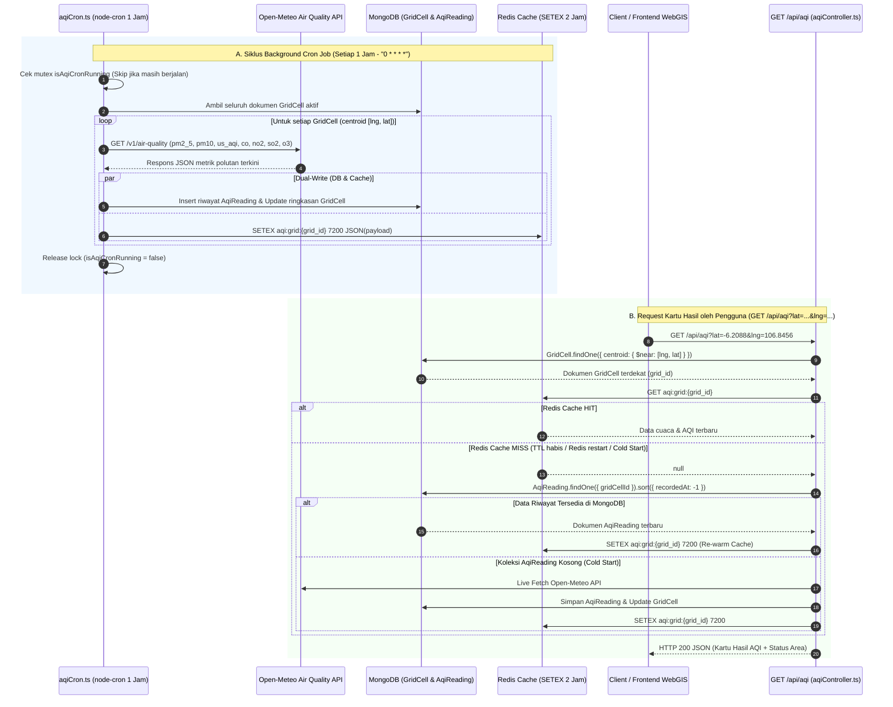

# Dokumentasi Teknis Alur 2: Penarikan Data Open-Meteo & Kartu Hasil (`GET /api/aqi`)

Dokumen ini menjelaskan arsitektur, alur kerja *Dual-Write*, penjadwalan Cron Job anti-overlap, pencarian geospasial `$near`, mekanisme prioritas baca Redis beserta penanganan *Cache Miss*, dan spesifikasi API untuk **Alur 2** pada backend **RespiraWatch WebGIS**.

---

## 1. Gambaran Arsitektur



---

## 2. Komponen & Lokasi File

| Komponen | Path File | Tanggung Jawab |
| :--- | :--- | :--- |
| **Service & Integrasi Eksternal** | [src/services/aqiService.ts](file:///Users/lo/Work/respira-watch/backend/src/services/aqiService.ts) | Client HTTP Open-Meteo API, kalkulasi EPA AQI, pemetaan status kesehatan area, *Dual-Write* (`AqiReading` + Redis `SETEX`), dan query `$near` dengan fallback berjenjang. |
| **Cron Job Andal** | [src/jobs/aqiCron.ts](file:///Users/lo/Work/respira-watch/backend/src/jobs/aqiCron.ts) | Penjadwalan `node-cron` setiap 1 jam (`0 * * * *`) dengan *in-memory mutex lock* (`isAqiCronRunning`) untuk mencegah eksekusi bertumpuk (*overlap*) serta blok `try-catch-finally` berlapis. |
| **Controller** | [src/controllers/aqiController.ts](file:///Users/lo/Work/respira-watch/backend/src/controllers/aqiController.ts) | Handler HTTP `getAqiByCoordinates` untuk menerima `req.query.lat` & `req.query.lng` dan mengembalikan respons standar Kartu Hasil. |
| **Route** | [src/routes/aqiRoutes.ts](file:///Users/lo/Work/respira-watch/backend/src/routes/aqiRoutes.ts) | Definisi endpoint `GET /api/aqi`. |
| **Model Database** | [src/models/AqiReading.ts](file:///Users/lo/Work/respira-watch/backend/src/models/AqiReading.ts) & [src/models/GridCell.ts](file:///Users/lo/Work/respira-watch/backend/src/models/GridCell.ts) | Skema penyimpanan riwayat waktu (*time-series history*) pembacaan kualitas udara dan indeks geospasial `2dsphere` pada sel grid. |

---

## 3. Penjelasan Detail Fitur Utama

### 3.1. Cron Job Andal & Anti-Overlap (`aqiCron.ts`)
- **Jadwal**: Menggunakan ekspresi `'0 * * * *'` pada zona waktu `Asia/Jakarta` (berjalan setiap 1 jam tepat di menit ke-0, plus *initial warm-up* asinkron saat server pertama kali menyala).
- **Pencegahan Overlap (Mutex Guard)**:
  Variabel state `isAqiCronRunning` memastikan bahwa apabila respons Open-Meteo melambat atau jumlah `GridCell` membesar hingga melewati siklus berikutnya, pemanggilan baru akan langsung dilewati (`skipped: true`) tanpa menumpuk proses di memori.
- **Isolasi Error (`try-catch-finally`)**:
  - Blok `try-catch` **di dalam loop** memastikan jika satu koordinat `GridCell` gagal diambil dari Open-Meteo, sel grid lainnya tetap diproses hingga selesai.
  - Blok `finally` **di level fungsi utama** menjamin `isAqiCronRunning = false` selalu dikembalikan meskipun terjadi *unhandled exception*.

### 3.2. Mekanisme Dual-Write (MongoDB & Redis `SETEX` 2 Jam)
Setiap kali data kualitas udara seorang `GridCell` berhasil ditarik dari Open-Meteo (`syncSingleGridCellAqi`), sistem mengeksekusi penulisan ganda secara paralel (`Promise.all`):
1. **MongoDB (`AqiReading` & `GridCell`)**:
   - Menambahkan dokumen riwayat baru ke koleksi `AqiReading` (`source: 'external_api'`) untuk kebutuhan audit dan analisis tren historis.
   - Memperbarui field `currentAqi`, `dominantPollutant`, `riskLevel`, dan `lastCalculatedAt` pada dokumen `GridCell`.
2. **Redis (`SETEX` TTL 7200 Detik / 2 Jam)**:
   - Menyimpan JSON ringkasan cuaca & polutan terbaru pada key `aqi:grid:{grid_id}` dengan perintah:
     ```ts
     await redisClient.setex(`aqi:grid:${gridId}`, 7200, JSON.stringify(payload));
     ```
   - **Mengapa TTL 2 Jam sedangkan Cron berjalan tiap 1 Jam?**
     Memberikan *grace window* selama 1 jam ekstra apabila terjadi gangguan jaringan sementara ke Open-Meteo pada salah satu jam eksekusi cron, sehingga cache Redis tidak langsung kosong.

### 3.3. Prioritas Baca Redis & Skenario Cache Miss
Saat endpoint `GET /api/aqi?lat=...&lng=...` diakses:
1. **Pencarian Spasial `$near`**:
   Mencari dokumen `GridCell` yang titik `centroid`-nya paling dekat dengan koordinat `[lng, lat]` pengguna menggunakan indeks `2dsphere`.
2. **Prioritas 1 — Baca Redis (`cacheMeta.source = "redis"`)**:
   Mengambil nilai langsung dari key `aqi:grid:{grid_id}` dalam waktu sub-milidetik.
3. **Prioritas 2 — Fallback MongoDB saat Cache Miss (`cacheMeta.source = "mongodb_fallback"`)**:
   - **Penyebab Cache Miss**:
     - Key Redis telah melewati TTL 2 jam (7200 detik).
     - Instance Redis baru saja di-restart atau mengalami kegagalan koneksi sementara.
     - Sel grid baru ditambahkan ke database sebelum jadwal cron per jam berikutnya berjalan.
   - **Tindakan Fallback**:
     Sistem mengambil dokumen `AqiReading` terbaru dari MongoDB (`AqiReading.findOne({ gridCellId }).sort({ recordedAt: -1 })`), lalu otomatis melakukan *re-warming* ke Redis dengan `SETEX` 2 jam agar request berikutnya kembali menjadi *Cache Hit*.
4. **Prioritas 3 — Live Fetch Open-Meteo saat Cold Start (`cacheMeta.source = "open_meteo_live"`)**:
   Jika Redis kosong **dan** koleksi `AqiReading` di MongoDB untuk sel grid tersebut juga belum memiliki dokumen sama sekali, sistem langsung memanggil Open-Meteo API secara *on-demand* dan menjalankan *Dual-Write*.

---

## 4. Klasifikasi Status Area & Rekomendasi Kesehatan

Fungsi `resolveAreaStatusFromAqi(aqi)` memetakan nilai indeks AQI ke kategori standar:

| Rentang AQI | Kategori (`category`) | Risk Level (`riskLevel`) | Label Status (`statusLabel`) | Warna (`colorHex`) | Aman Luar Ruangan (`isSafeForOutdoor`) |
| :--- | :--- | :--- | :--- | :--- | :--- |
| **0 – 50** | `baik` | `safe` | Baik (Aman) | `#10B981` (Hijau) | `true` |
| **51 – 100** | `sedang` | `moderate` | Sedang (Moderat) | `#F59E0B` (Kuning) | `true` |
| **101 – 150** | `tidak_sehat_bagi_kelompok_sensitif` | `unhealthy` | Tidak Sehat bagi Kelompok Sensitif | `#F97316` (Oranye) | `false` |
| **151 – 200** | `tidak_sehat` | `unhealthy` | Tidak Sehat | `#EF4444` (Merah) | `false` |
| **201 – 300** | `sangat_tidak_sehat` | `very_unhealthy` | Sangat Tidak Sehat | `#8B5CF6` (Ungu) | `false` |
| **> 300** | `berbahaya` | `hazardous` | Berbahaya (Darurat Polusi) | `#7F1D1D` (Marun) | `false` |

---

## 5. Spesifikasi Endpoint `GET /api/aqi`

### Request
```http
GET /api/aqi?lat=-6.208763&lng=106.845599 HTTP/1.1
Host: localhost:4000
Accept: application/json
```

#### Parameter Query
| Parameter | Tipe | Wajib | Rentang Valid | Deskripsi |
| :--- | :--- | :--- | :--- | :--- |
| `lat` | `number` | Ya | `-90` s/d `90` | Koordinat lintang (*latitude*) posisi pengguna. |
| `lng` | `number` | Ya | `-180` s/d `180` | Koordinat bujur (*longitude*) posisi pengguna. |

### Contoh Respons Sukses (`200 OK`)
```json
{
  "success": true,
  "message": "Data kualitas udara dan status area berhasil dimuat.",
  "data": {
    "grid_id": "67343b9f1c9d440000a1b2c3",
    "cellCode": "GRID-31-74-01-1001",
    "queryCoordinates": {
      "lat": -6.208763,
      "lng": 106.845599
    },
    "gridCentroid": {
      "lat": -6.208763,
      "lng": 106.845599
    },
    "distanceMeters": 0,
    "kelurahan": {
      "id": "67343b9e1c9d440000a1b2c0",
      "code": "31.74.01.1001",
      "name": "Manggarai",
      "kecamatan": "Tebet",
      "kota": "Jakarta Selatan",
      "provinsi": "DKI Jakarta"
    },
    "weatherAqi": {
      "aqi": 154,
      "pm25": 58.2,
      "pm10": 74.5,
      "pollutants": {
        "pm25": 58.2,
        "pm10": 74.5,
        "co": 1420,
        "no2": 34.1,
        "so2": 18.5,
        "o3": 92
      },
      "dominantPollutant": "PM2.5",
      "recordedAt": "2026-11-13T05:00:00.000Z",
      "source": "external_api"
    },
    "areaStatus": {
      "category": "tidak_sehat",
      "riskLevel": "unhealthy",
      "statusLabel": "Tidak Sehat",
      "colorHex": "#EF4444",
      "isSafeForOutdoor": false,
      "healthRecommendation": "Hindari olahraga atau aktivitas fisik berat di luar ruangan. Gunakan masker pelindung dan nyalakan penjernih udara di dalam ruangan.",
      "sensitiveGroupWarning": "Kelompok rentan (penderita ISPA, asma, penyakit jantung) harus tetap berada di dalam ruangan.",
      "activeReportCount": 0,
      "vulnerabilityIndex": 0.7
    },
    "cacheMeta": {
      "key": "aqi:grid:67343b9f1c9d440000a1b2c3",
      "hit": true,
      "source": "redis",
      "ttlSeconds": 7200
    }
  }
}
```

### Contoh Respons Error Validasi (`400 Bad Request`)
```json
{
  "success": false,
  "message": "Parameter query lat (latitude) dan lng (longitude) wajib disertakan."
}
```
