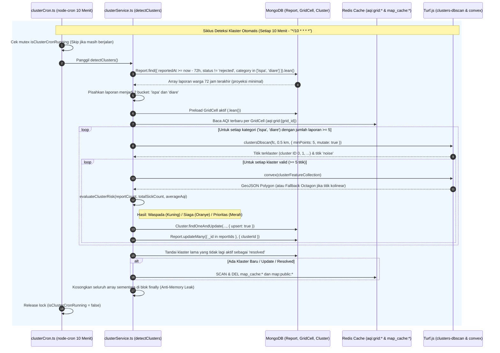

# Dokumentasi Teknis Alur 3: Mesin Deteksi Klaster Spasial-Temporal (`DBSCAN` & `Convex Hull`)

Dokumen ini menjelaskan arsitektur komputasi spasial-temporal menggunakan **Turf.js** (`@turf/clusters-dbscan` & `@turf/convex`), logika penentuan tingkat risiko (**Waspada / Kuning**, **Siaga / Oranye**, **Prioritas / Merah**), mekanisme *Upsert* & *Cache Invalidation* Redis (`del map_cache:*`), strategi pencegahan *memory leak*, penjadwalan `node-cron` setiap 10 menit, serta spesifikasi REST API untuk **Alur 3** pada backend **RespiraWatch WebGIS**.

---

## 1. Gambaran Arsitektur



---

## 2. Komponen & Lokasi File

| Komponen | Path File | Tanggung Jawab |
| :--- | :--- | :--- |
| **Mesin Spasial-Temporal** | [src/services/clusterService.ts](file:///Users/lo/Work/respira-watch/backend/src/services/clusterService.ts) | Implementasi `detectClusters()`, pengelompokan `@turf/clusters-dbscan` (0.5 km, `minPoints: 5`), pembentukan poligon `@turf/convex`, kalkulasi risiko `evaluateClusterRisk()`, *upsert* ke koleksi `Cluster`, dan invalidasi cache `map_cache:*`. |
| **Cron Job 10 Menit** | [src/jobs/clusterCron.ts](file:///Users/lo/Work/respira-watch/backend/src/jobs/clusterCron.ts) | Penjadwalan `node-cron` setiap 10 menit (`*/10 * * * *`, WIB) dengan *mutex guard* `isClusterCronRunning` agar tidak terjadi eksekusi bertumpuk (*overlapping*). |
| **Model Database** | [src/models/Cluster.ts](file:///Users/lo/Work/respira-watch/backend/src/models/Cluster.ts) | Skema Mongoose `Cluster` berindeks `2dsphere` (`center` & `boundary`), menyimpan `category`, `riskStatus`, `riskColor`, `colorHex`, `reportCount`, `totalSickCount`, dan `averageAqi`. |
| **Controller & Route** | [src/controllers/clusterController.ts](file:///Users/lo/Work/respira-watch/backend/src/controllers/clusterController.ts) & [src/routes/clusterRoutes.ts](file:///Users/lo/Work/respira-watch/backend/src/routes/clusterRoutes.ts) | Endpoint HTTP `GET /api/clusters`, `GET /api/clusters/:id`, dan pemicu manual `POST /api/clusters/detect`. |

---

## 3. Penjelasan Detail Fitur Utama

### 3.1. Kalkulasi Spasial-Temporal (`detectClusters()`)
1. **Jendela Waktu 72 Jam Terakhir**:
   - Menarik laporan warga dengan `reportedAt >= (Date.now() - 72 jam)` dan `status !== 'rejected'`.
2. **Pemisahan Kategori Penyakit (`'ispa'` vs `'diare'`)**:
   - Laporan dipisahkan secara ketat antara `'ispa'` dan `'diare'` sebelum diproses oleh DBSCAN sehingga klaster penyakit pernapasan dan pencernaan tidak pernah tercampur.
3. **Algoritma `@turf/clusters-dbscan`**:
   - **Radius (`maxDistance`)**: `0.5` kilometer (`500` meter).
   - **Minimum Titik (`minPoints`)**: `5` laporan.
   - **Mutasi In-Place (`mutate: true`)**: Memodifikasi `FeatureCollection` secara langsung tanpa menduplikasi seluruh objek di memori.
4. **Poligon Batas Klaster (`@turf/convex` + Fallback Kolinear)**:
   - Setiap kelompok titik klaster diubah menjadi poligon tertutup menggunakan `@turf/convex`.
   - **Edge-Case Handling**: Jika seluruh titik laporan dalam satu klaster kebetulan segaris lurus (kolinear) atau berada di titik koordinat yang sama persis sehingga `@turf/convex` mengembalikan `null`, fungsi `buildFallbackPolygonAroundCenter()` otomatis membentuk poligon segi delapan (*octagon buffer* radius ~100m) di sekitar *centroid* agar indeks geospasial `2dsphere` MongoDB tetap valid.

---

### 3.2. Logika Evaluasi Risiko (`evaluateClusterRisk()`)

Status risiko klaster ditentukan berdasarkan kombinasi jumlah laporan (`reportCount`), total warga sakit (`totalSickCount`), kategori penyakit (`category`), dan rata-rata kualitas udara (`averageAqi`) di sel grid terdekat:

| Status Risiko (`riskStatus`) | Warna (`riskColor`) | Kode Warna (`colorHex`) | Mapping `riskLevel` | Kriteria Pemicu |
| :--- | :--- | :--- | :--- | :--- |
| **Prioritas** | `Merah` | `#EF4444` | `outbreak` | • `reportCount >= 15`, **ATAU**<br>• `reportCount >= 10` disertai `averageAqi > 150`, **ATAU**<br>• `category === 'ispa'` dengan `reportCount >= 8` & `averageAqi > 200`, **ATAU**<br>• `totalSickCount >= 25` |
| **Siaga** | `Oranye` | `#F97316` | `high` | • `reportCount >= 8`, **ATAU**<br>• `reportCount >= 5` disertai `averageAqi > 100`, **ATAU**<br>• `totalSickCount >= 12` |
| **Waspada** | `Kuning` | `#EAB308` | `moderate` | • Klaster valid (`reportCount >= 5`) dengan kualitas udara normal (`averageAqi <= 100`) |

---

### 3.3. Upsert MongoDB & Cache Invalidation (`del map_cache:*`)
1. **Resolusi & Upsert Klaster Deterministik**:
   - Sistem mencari klaster aktif/monitoring dengan `category` yang sama dalam radius `500m` (`$near`) dari *centroid* baru, atau mencocokkan kode klaster deterministik `CLU-{CATEGORY}-{LAT}-{LNG}`.
   - Melakukan `Cluster.findOneAndUpdate(..., { upsert: true, new: true })` sehingga siklus cron setiap 10 menit memperbarui klaster yang sudah ada tanpa membuat duplikasi dokumen.
   - Menautkan seluruh laporan anggota ke klaster melalui `Report.updateMany({ _id: { $in: reportIds } }, { $set: { clusterId } })`.
   - Klaster lama yang tidak lagi memenuhi ambang batas dalam 72 jam terakhir otomatis diubah statusnya menjadi `'resolved'`.
2. **Invalidasi Cache Peta Publik**:
   - Setiap kali terjadi penambahan, pembaruan, atau penyelesaian klaster, fungsi `invalidateMapCacheAfterClusterUpsert()` wajib mengeksekusi penghapusan cache Redis dengan pattern `map_cache:*` (serta alias `map:public:*`) menggunakan metode non-blocking `SCAN` + `DEL`.

---

### 3.4. Desain Efisien & Aman dari Memory Leak
- **Lean Queries & Proyeksi Ketat**: Query MongoDB menggunakan `.select('_id category symptoms sickCount severity geom location kelurahanId gridCellId reportedAt').lean()` untuk menghindari overhead instansiasi dokumen Mongoose.
- **Zero N+1 Query**: Data `GridCell` dan cache AQI Redis (`aqi:grid:{id}`) di-*preload* satu kali di awal siklus (`preloadGridAqiSnapshots`), lalu pencarian sel terdekat dilakukan di memori menggunakan rumus Haversine (`calculateDistanceMeters`).
- **In-Place DBSCAN (`mutate: true`)**: Menghindari penggandaan struktur objek GeoJSON di heap V8.
- **Pembersihan Eksplisit (`finally`)**: Seluruh `Map` (`groupedClusters.clear()`, `freqMap.clear()`) dan array penampung dikosongkan (`array.length = 0`) di dalam blok `finally` agar *Garbage Collector* V8 dapat segera membebaskan memori.

---

## 4. Spesifikasi Endpoint REST API Klaster

### Ringkasan Endpoint
| Method | Endpoint | Deskripsi |
| :--- | :--- | :--- |
| `GET` | `/api/clusters` | Mengambil daftar klaster penyakit (default: status `active` & `monitoring`) beserta poligon batas (`boundary`) dan status risiko. |
| `GET` | `/api/clusters/:id` | Mengambil detail satu klaster berdasarkan MongoDB `ObjectId` atau `clusterCode` (contoh: `CLU-ISPA-S06209-E106846`). |
| `POST` | `/api/clusters/detect` | Memicu kalkulasi `detectClusters()` secara manual (on-demand) dan meng-invalidate cache `map_cache:*`. |

---

### 4.1. `GET /api/clusters`

#### Parameter Query (Opsional)
| Parameter | Nilai yang Didukung | Deskripsi |
| :--- | :--- | :--- |
| `category` / `kategori` | `ispa`, `diare` | Memfilter klaster berdasarkan jenis penyakit. |
| `riskStatus` | `Waspada`, `Siaga`, `Prioritas` | Memfilter klaster berdasarkan tingkat risiko. |
| `status` | `active`, `monitoring`, `resolved` | Memfilter berdasarkan status penanganan klaster. |
| `kelurahanId` | `ObjectId` | Memfilter klaster pada satu wilayah Kelurahan. |

#### Contoh Respons (`200 OK`)
```json
{
  "success": true,
  "message": "Daftar klaster spasial-temporal berhasil dimuat.",
  "data": [
    {
      "_id": "67346a109c8d440000e1f2a3",
      "clusterCode": "CLU-ISPA-S06210-E106845",
      "category": "ispa",
      "kelurahanId": {
        "_id": "67343b9e1c9d440000a1b2c0",
        "code": "31.74.01.1001",
        "name": "Manggarai",
        "kecamatan": "Tebet",
        "kota": "Jakarta Selatan",
        "provinsi": "DKI Jakarta"
      },
      "center": {
        "type": "Point",
        "coordinates": [106.845612, -6.208814]
      },
      "boundary": {
        "type": "Polygon",
        "coordinates": [
          [
            [106.844812, -6.209514],
            [106.846512, -6.209314],
            [106.846212, -6.207914],
            [106.844612, -6.208114],
            [106.844812, -6.209514]
          ]
        ]
      },
      "radiusMeters": 142,
      "reportCount": 6,
      "totalSickCount": 11,
      "averageAqi": 138,
      "dominantSymptoms": ["batuk kering", "sesak napas", "demam"],
      "riskStatus": "Siaga",
      "riskColor": "Oranye",
      "colorHex": "#F97316",
      "riskLevel": "high",
      "status": "active",
      "firstDetectedAt": "2026-11-12T08:15:00.000Z",
      "lastUpdatedAt": "2026-11-13T06:50:00.000Z"
    }
  ]
}
```

---

### 4.2. `POST /api/clusters/detect`

#### Contoh Respons (`200 OK`)
```json
{
  "success": true,
  "message": "Deteksi klaster spasial-temporal (DBSCAN 0.5 km, minPoints: 5) berhasil dijalankan dan cache peta telah disegarkan.",
  "data": {
    "windowStartIso": "2026-11-10T06:50:00.000Z",
    "windowEndIso": "2026-11-13T06:50:00.000Z",
    "totalReportsFetched": 9,
    "reportsByCategory": {
      "ispa": 6,
      "diare": 3
    },
    "clustersDetected": 1,
    "clustersByCategory": {
      "ispa": 1,
      "diare": 0
    },
    "upsertedClusterIds": [
      "67346a109c8d440000e1f2a3"
    ],
    "resolvedStaleCount": 0,
    "cacheInvalidated": true,
    "clusters": [
      {
        "_id": "67346a109c8d440000e1f2a3",
        "clusterCode": "CLU-ISPA-S06210-E106845",
        "category": "ispa",
        "reportCount": 6,
        "totalSickCount": 11,
        "averageAqi": 138,
        "riskStatus": "Siaga",
        "riskColor": "Oranye",
        "colorHex": "#F97316",
        "riskLevel": "high",
        "status": "active"
      }
    ]
  }
}
```
