# Dokumentasi Teknis Alur 4: Real-Time (Socket.io) & Dasbor Petugas

Dokumen ini menjelaskan arsitektur komunikasi *real-time* menggunakan **Socket.io** dengan autentikasi JWT pada fase *handshake*, kontrak payload *event broadcast* (`report:new`, `cluster:detected`, `cluster:updated`), spesifikasi REST API manajemen klaster penyakit (`GET /api/clusters`, `GET /api/clusters/:id`, `PATCH /api/clusters/:id`), serta strategi *Caching* (TTL 5 menit) dan *Cache Invalidation* Redis untuk **Alur 4** pada backend **RespiraWatch WebGIS**.

---

## 1. Gambaran Arsitektur

```mermaid
sequenceDiagram
    autonumber
    participant Warga as Warga / Cron DBSCAN
    participant API as Express Controller & Service
    participant Mongo as MongoDB (Cluster, Report, Officer)
    participant Redis as Redis Cache (TTL 300s)
    participant Socket as Socket.io Server (JWT Handshake Guard)
    participant Dashboard as Dasbor Petugas (WebGIS)

    rect rgb(245, 243, 255)
        Note over Socket,Dashboard: 1. Fase Handshake WebSocket Terautentikasi JWT
        Dashboard->>Socket: Connect WebSocket (auth.token / Header Authorization: Bearer <JWT>)
        Socket->>Socket: verifyOfficerToken(token) (HS256 via jose)
        Socket->>Mongo: Officer.findById(officerId).select('isActive role assignedKelurahan')
        alt Token Valid & Petugas Aktif
            Socket-->>Dashboard: Emit "connection:authenticated" & Join Rooms (officers, role:*, kelurahan:*)
        else Token Kosong / Invalid / Nonaktif
            Socket-->>Dashboard: Reject Handshake (Error: UNAUTHORIZED / FORBIDDEN)
        end
    end

    rect rgb(240, 249, 255)
        Note over Warga,Dashboard: 2. Broadcast Real-Time Laporan Baru & Deteksi Klaster
        Warga->>API: POST /api/reports
        API->>Mongo: Simpan / Update Laporan Warga
        API->>Redis: DEL map_cache:*
        API->>Socket: emitNewReport("report:new", payload koordinat presisi)
        Socket-->>Dashboard: Push Real-Time Event "report:new"

        Warga->>API: Cron DBSCAN (10m) / POST /api/clusters/detect
        API->>Mongo: Upsert Cluster & Update Report.clusterId
        API->>Redis: DEL clusters:list:*, clusters:detail:*, map_cache:*
        API->>Socket: emitClusterDetected("cluster:detected", payload)
        Socket-->>Dashboard: Push Real-Time Event "cluster:detected"
    end

    rect rgb(254, 249, 195)
        Note over API,Dashboard: 3. Query Klaster oleh Petugas (Redis Cache TTL 5 Menit)
        Dashboard->>API: GET /api/clusters?status=active&level=Siaga
        API->>Redis: GET clusters:list:level=siaga&status=active
        alt Cache HIT
            Redis-->>API: Array Klaster dari Memori Redis
        else Cache MISS
            API->>Mongo: Cluster.find(query).populate('kelurahanId assignedOfficerId')
            Mongo-->>API: Dokumen Klaster
            API->>Redis: SETEX clusters:list:level=siaga&status=active (TTL: 300s)
        end
        API-->>Dashboard: 200 OK (Daftar Klaster)
    end

    rect rgb(220, 252, 231)
        Note over API,Dashboard: 4. Pembaruan Status Klaster & Invalidasi Redis (Anti Stale Data)
        Dashboard->>API: PATCH /api/clusters/:id { "status": "monitoring" }
        API->>Mongo: Update Cluster (status, assignedOfficerId, lastUpdatedAt)
        API->>Redis: DEL clusters:detail:<id> & clusters:detail:<clusterCode>
        API->>Redis: SCAN & DEL clusters:list:* dan map_cache:*
        API->>Socket: emitClusterUpdated("cluster:updated", payload)
        Socket-->>Dashboard: Push Real-Time Event "cluster:updated"
        API-->>Dashboard: 200 OK (Data Klaster Terbaru)
    end
```



---

## 2. Komponen & Lokasi File

| Komponen | Path File | Tanggung Jawab |
| :--- | :--- | :--- |
| **Konfigurasi & Server Socket.io** | [src/config/socket.ts](file:///Users/lo/Work/respira-watch/backend/src/config/socket.ts) & [src/sockets/index.ts](file:///Users/lo/Work/respira-watch/backend/src/sockets/index.ts) | Inisialisasi `SocketIOServer`, middleware autentikasi JWT saat *handshake* (`io.use`), manajemen *room* (`officers`, `role:*`, `kelurahan:*`), serta helper *broadcast* (`emitNewReport`, `emitClusterDetected`, `emitClusterUpdated`). |
| **Entrypoint HTTP + WebSocket** | [src/index.ts](file:///Users/lo/Work/respira-watch/backend/src/index.ts) | Mengikat Express dan Socket.io pada satu instance `http.Server` Node.js. |
| **Service Klaster & State Redis** | [src/services/clusterService.ts](file:///Users/lo/Work/respira-watch/backend/src/services/clusterService.ts) | Filter `listClusters()` (`status`, `level`/`riskLevel`/`riskStatus`, `category`, `kelurahanId`) dengan cache Redis TTL 300 detik, `getClusterByIdOrCode()` dengan cache detail klaster, `updateClusterStatus()`, dan `invalidateClusterCaches()`. |
| **Controller & Route Klaster** | [src/controllers/clusterController.ts](file:///Users/lo/Work/respira-watch/backend/src/controllers/clusterController.ts) & [src/routes/clusterRoutes.ts](file:///Users/lo/Work/respira-watch/backend/src/routes/clusterRoutes.ts) | Endpoint HTTP `GET /api/clusters`, `GET /api/clusters/:id`, `PATCH /api/clusters/:id` (dilindungi JWT & RBAC), dan `POST /api/clusters/detect`. |
| **Integrasi Broadcast Laporan** | [src/services/reportService.ts](file:///Users/lo/Work/respira-watch/backend/src/services/reportService.ts) | Memancarkan event `report:new` secara otomatis setelah laporan warga disimpan/diperbarui. |

---

## 3. Spesifikasi WebSocket (Socket.io)

### 3.1. Autentikasi JWT pada Fase Handshake
Koneksi WebSocket dilindungi oleh middleware `io.use(...)` di [src/config/socket.ts](file:///Users/lo/Work/respira-watch/backend/src/config/socket.ts). Klien wajib menyertakan token JWT petugas yang valid melalui salah satu dari 3 mekanisme berikut saat melakukan *handshake*:

1. **Melalui `auth.token` (Direkomendasikan untuk `socket.io-client`)**:
   ```ts
   import { io } from 'socket.io-client';

   const socket = io('http://localhost:4000', {
     auth: {
       token: '<JWT_TOKEN_PETUGAS>',
     },
     transports: ['websocket'],
   });
   ```
2. **Melalui Header HTTP `Authorization`**:
   ```http
   Authorization: Bearer <JWT_TOKEN_PETUGAS>
   ```
3. **Melalui Query Parameter `token`**:
   ```text
   ws://localhost:4000/socket.io/?EIO=4&transport=websocket&token=<JWT_TOKEN_PETUGAS>
   ```

> **Penanganan Penolakan Koneksi (`connect_error`):**
> - Jika token tidak disertakan: `UNAUTHORIZED: Token autentikasi JWT wajib disertakan pada saat handshake (auth.token atau header Authorization).`
> - Jika token tidak valid / kedaluwarsa: `UNAUTHORIZED: Token JWT tidak valid atau telah kedaluwarsa.`
> - Jika akun petugas berstatus `isActive: false`: `FORBIDDEN: Akun petugas sedang dinonaktifkan.`

---

### 3.2. Pembagian Room Socket.io
Begitu *handshake* terverifikasi, socket petugas otomatis dimasukkan ke dalam *room* berikut:
- `officers`: Room utama berisi seluruh petugas aktif (`admin`, `field_officer`, `health_analyst`).
- `role:<role>`: Room spesifik berdasarkan peran (mis. `role:field_officer`, `role:health_analyst`, `role:admin`).
- `kelurahan:<kelurahanId>`: Room spesifik wilayah tugas apabila petugas memiliki `assignedKelurahan`.

---

### 3.3. Format Payload Event Socket.io

#### A. Event `connection:authenticated` (Server -> Client)
Dikirimkan langsung ke socket petugas sesaat setelah koneksi berhasil terautentikasi.
```json
{
  "socketId": "p9K2mN8xVqL1aBcD",
  "officer": {
    "officerId": "67343b9e1c9d440000a1b2c1",
    "name": "Budi Santoso",
    "email": "petugas@respirawatch.id",
    "role": "field_officer",
    "nip": "199203122021011002",
    "assignedKelurahan": "67343b9e1c9d440000a1b2c0"
  },
  "rooms": [
    "officers",
    "role:field_officer",
    "kelurahan:67343b9e1c9d440000a1b2c0"
  ],
  "connectedAt": "2026-11-13T15:30:00.000Z"
}
```

#### B. Event `report:new` (Server Broadcast -> Room `officers`)
Dipancarkan secara *real-time* saat warga mengirim laporan keluhan melalui `POST /api/reports`. Menyertakan koordinat **presisi (`geom`)** tanpa *jittering* khusus untuk intervensi petugas.
```json
{
  "event": "report:new",
  "isUpdated": false,
  "report": {
    "id": "67346a109c8d440000e1f299",
    "reporterName": "Warga Anonim",
    "category": "ispa",
    "symptoms": ["batuk kering", "sesak napas"],
    "sickCount": 2,
    "age": 34,
    "severity": "berat",
    "status": "pending",
    "geom": {
      "type": "Point",
      "coordinates": [106.845612, -6.208814]
    },
    "address": "Jl. Manggarai Utara II No. 12",
    "kelurahanId": "67343b9e1c9d440000a1b2c0",
    "reportedAt": "2026-11-13T15:32:10.000Z"
  },
  "emittedAt": "2026-11-13T15:32:10.050Z"
}
```

#### C. Event `cluster:detected` (Server Broadcast -> Room `officers`)
Dipancarkan secara *real-time* ketika mesin spasial-temporal DBSCAN (baik melalui cron 10 menit maupun `POST /api/clusters/detect`) mendeteksi klaster baru atau memperbarui klaster aktif.
```json
{
  "event": "cluster:detected",
  "clustersDetected": 1,
  "clustersByCategory": {
    "ispa": 1,
    "diare": 0
  },
  "upsertedClusterIds": [
    "67346a109c8d440000e1f2a3"
  ],
  "resolvedStaleCount": 0,
  "clusters": [
    {
      "id": "67346a109c8d440000e1f2a3",
      "clusterCode": "CLU-ISPA-S06210-E106845",
      "category": "ispa",
      "kelurahanId": "67343b9e1c9d440000a1b2c0",
      "center": {
        "type": "Point",
        "coordinates": [106.845612, -6.208814]
      },
      "boundary": {
        "type": "Polygon",
        "coordinates": [
          [
            [106.844812, -6.209514],
            [106.846512, -6.209314],
            [106.846212, -6.207914],
            [106.844612, -6.208114],
            [106.844812, -6.209514]
          ]
        ]
      },
      "radiusMeters": 142,
      "reportCount": 6,
      "totalSickCount": 11,
      "averageAqi": 138,
      "dominantSymptoms": ["batuk kering", "sesak napas", "demam"],
      "riskStatus": "Siaga",
      "riskColor": "Oranye",
      "colorHex": "#F97316",
      "riskLevel": "high",
      "status": "active",
      "firstDetectedAt": "2026-11-12T08:15:00.000Z",
      "lastUpdatedAt": "2026-11-13T15:35:00.000Z"
    }
  ],
  "detectedAt": "2026-11-13T15:35:00.120Z"
}
```

#### D. Event `cluster:updated` (Server Broadcast -> Room `officers`)
Dipancarkan secara *real-time* ketika petugas mengubah status penanganan klaster melalui `PATCH /api/clusters/:id`.
```json
{
  "event": "cluster:updated",
  "clusterId": "67346a109c8d440000e1f2a3",
  "clusterCode": "CLU-ISPA-S06210-E106845",
  "previousStatus": "active",
  "status": "monitoring",
  "riskStatus": "Siaga",
  "riskLevel": "high",
  "assignedOfficerId": "67343b9e1c9d440000a1b2c1",
  "updatedBy": {
    "officerId": "67343b9e1c9d440000a1b2c1",
    "email": "petugas@respirawatch.id",
    "role": "field_officer"
  },
  "cluster": {
    "id": "67346a109c8d440000e1f2a3",
    "clusterCode": "CLU-ISPA-S06210-E106845",
    "category": "ispa",
    "kelurahanId": "67343b9e1c9d440000a1b2c0",
    "center": {
      "type": "Point",
      "coordinates": [106.845612, -6.208814]
    },
    "radiusMeters": 142,
    "reportCount": 6,
    "totalSickCount": 11,
    "averageAqi": 138,
    "dominantSymptoms": ["batuk kering", "sesak napas", "demam"],
    "riskStatus": "Siaga",
    "riskColor": "Oranye",
    "colorHex": "#F97316",
    "riskLevel": "high",
    "status": "monitoring",
    "assignedOfficerId": "67343b9e1c9d440000a1b2c1",
    "firstDetectedAt": "2026-11-12T08:15:00.000Z",
    "lastUpdatedAt": "2026-11-13T15:40:00.000Z"
  },
  "updatedAt": "2026-11-13T15:40:00.000Z"
}
```

---

## 4. Spesifikasi Endpoint REST API Dasbor Petugas

### Ringkasan Endpoint
| Method | Endpoint | Auth | Deskripsi |
| :--- | :--- | :--- | :--- |
| `GET` | `/api/clusters` | Publik / Petugas | Mengambil daftar klaster penyakit dengan filter (`status`, `level`, `category`, `kelurahanId`). **Di-cache di Redis (TTL 5 menit / 300 detik)**. |
| `GET` | `/api/clusters/:id` | Publik / Petugas | Mengambil detail klaster berdasarkan `ObjectId` atau `clusterCode`. **Di-cache di Redis (TTL 5 menit / 300 detik)**. |
| `PATCH` | `/api/clusters/:id` | Bearer JWT (`admin`, `field_officer`, `health_analyst`) | Mengubah status penanganan klaster (`active`, `monitoring`, `resolved`), meng-invalidate cache Redis detail & daftar klaster, serta mengirim broadcast `cluster:updated`. |
| `POST` | `/api/clusters/detect` | Publik / Petugas | Memicu deteksi klaster DBSCAN secara manual, meng-invalidate cache Redis, dan mengirim broadcast `cluster:detected`. |

---

### 4.1. `GET /api/clusters` (Filter & Redis Cache TTL 5 Menit)

#### Parameter Query (Opsional)
| Parameter | Nilai yang Didukung | Deskripsi |
| :--- | :--- | :--- |
| `status` | `active`, `monitoring`, `resolved`, `all` | Memfilter klaster berdasarkan status penanganan (default jika kosong: `active` & `monitoring`). |
| `level` / `riskLevel` / `riskStatus` | `Waspada`, `Siaga`, `Prioritas` **atau** `low`, `moderate`, `high`, `outbreak` | Memfilter klaster berdasarkan tingkat/level keparahan risiko (*case-insensitive*). |
| `category` / `kategori` | `ispa`, `diare` | Memfilter klaster berdasarkan jenis penyakit. |
| `kelurahanId` | `ObjectId` | Memfilter klaster pada satu wilayah Kelurahan. |

#### Contoh Request
```http
GET /api/clusters?status=active&level=Siaga&category=ispa HTTP/1.1
Host: localhost:4000
```

---

### 4.2. `PATCH /api/clusters/:id` (Update Status & Cache Invalidation)

#### Parameter URL
- `:id` — Dapat berupa MongoDB `ObjectId` (contoh: `67346a109c8d440000e1f2a3`) maupun `clusterCode` (contoh: `CLU-ISPA-S06210-E106845`).

#### Header
```http
Authorization: Bearer <JWT_TOKEN_PETUGAS>
Content-Type: application/json
```

#### Body Request
```json
{
  "status": "monitoring",
  "assignedOfficerId": "67343b9e1c9d440000a1b2c1"
}
```
- `status` (**wajib**): `'active' | 'monitoring' | 'resolved'`.
- `assignedOfficerId` (*opsional*): `ObjectId` petugas yang ditugaskan. Jika dikosongkan dan klaster belum memiliki petugas penanggung jawab, otomatis diisi dengan `officerId` dari token JWT pemanggil.

#### Contoh Respons (`200 OK`)
```json
{
  "success": true,
  "message": "Status penanganan klaster berhasil diperbarui dan cache Redis telah disegarkan.",
  "data": {
    "_id": "67346a109c8d440000e1f2a3",
    "clusterCode": "CLU-ISPA-S06210-E106845",
    "category": "ispa",
    "status": "monitoring",
    "riskStatus": "Siaga",
    "riskColor": "Oranye",
    "colorHex": "#F97316",
    "riskLevel": "high",
    "reportCount": 6,
    "totalSickCount": 11,
    "averageAqi": 138,
    "assignedOfficerId": {
      "_id": "67343b9e1c9d440000a1b2c1",
      "name": "Budi Santoso",
      "email": "petugas@respirawatch.id",
      "role": "field_officer"
    },
    "lastUpdatedAt": "2026-11-13T15:40:00.000Z"
  }
}
```

---

## 5. Manajemen State & Kunci Cache Redis

| Jenis Cache | Pola Kunci Redis | TTL | Strategi Invalidasi (`PATCH /api/clusters/:id` & `detectClusters`) |
| :--- | :--- | :--- | :--- |
| **Daftar Klaster** | `clusters:list:<sorted_query_params>` | `300s` (5 menit) | Dihapus seluruhnya via `SCAN` + `DEL clusters:list:*` setiap kali status klaster diubah atau DBSCAN mendeteksi perubahan. |
| **Detail Klaster (by ID)** | `clusters:detail:<_id>` | `300s` (5 menit) | Dihapus spesifik via `DEL clusters:detail:<_id>` saat klaster tersebut di-PATCH. |
| **Detail Klaster (by Code)** | `clusters:detail:<clustercode>` | `300s` (5 menit) | Dihapus spesifik via `DEL clusters:detail:<clustercode>` saat klaster tersebut di-PATCH. |
| **Peta Publik** | `map_cache:*` & `map:public:*` | `300s` (5 menit) | Ikut disegarkan via `SCAN` + `DEL` agar perubahan status laporan/klaster tercermin di peta. |
