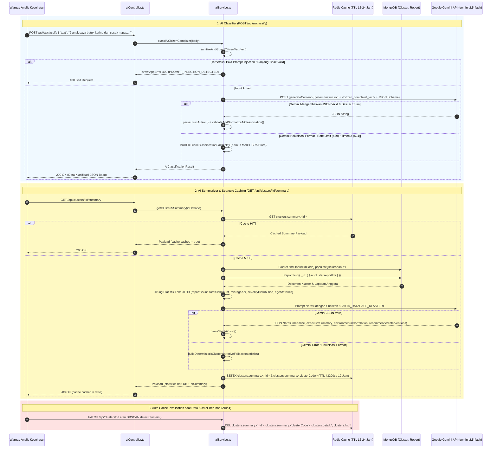

# Dokumentasi Teknis Alur 5: AI Generative untuk Klasifikasi & Ringkasan (`Google Gemini API`)

Dokumen ini menjelaskan arsitektur integrasi **Google Gemini API** pada backend **RespiraWatch WebGIS**, mencakup:
1. **AI Classifier (`POST /api/ai/classify`)** dengan **Prompt Injection Defense**, pemaksaan JSON ketat (`responseMimeType: "application/json"` & `responseSchema`), serta validasi `JSON.parse` dengan **Safe Heuristic Fallback**.
2. **AI Summarizer (`GET /api/clusters/:id/summary`)** dengan **injeksi angka statistik faktual langsung dari MongoDB** (anti-halusinasi numerik).
3. **Strategic AI Caching di Redis** (`clusters:summary:<id>`, TTL 12–24 jam) yang terintegrasi langsung dengan mekanisme *cache invalidation* pada **Alur 4** (`PATCH /api/clusters/:id` dan DBSCAN *upsert*).
4. **Skema Error Handling dari Gemini API**.

---

## 1. Gambaran Arsitektur



---

## 2. Komponen & Lokasi File

| Komponen | Path File | Tanggung Jawab |
| :--- | :--- | :--- |
| **Layanan AI Generative** | [src/services/aiService.ts](file:///Users/lo/Work/respira-watch/backend/src/services/aiService.ts) | Implementasi `sanitizeAndGuardCitizenText()`, `parseStrictAiJson()`, `callGeminiGenerateJson()`, `classifyCitizenComplaint()`, `getClusterAiSummary()`, `invalidateClusterSummaryCache()`, serta fallback deterministik. |
| **Controller AI** | [src/controllers/aiController.ts](file:///Users/lo/Work/respira-watch/backend/src/controllers/aiController.ts) | Handler HTTP `classifyComplaint` (`POST /api/ai/classify`) dan `getClusterSummary` (`GET /api/clusters/:id/summary`). |
| **Routing AI & Klaster** | [src/routes/aiRoutes.ts](file:///Users/lo/Work/respira-watch/backend/src/routes/aiRoutes.ts) & [src/routes/clusterRoutes.ts](file:///Users/lo/Work/respira-watch/backend/src/routes/clusterRoutes.ts) | Ekspos endpoint `/api/ai/classify` dan `/api/clusters/:id/summary`. |
| **Integrasi Invalidasi Klaster** | [src/services/clusterService.ts](file:///Users/lo/Work/respira-watch/backend/src/services/clusterService.ts) | Memanggil `invalidateClusterSummaryCache(clusterId, clusterCode)` di dalam `invalidateClusterCaches()`. |

---

## 3. Spesifikasi Endpoint & Fitur Utama

### 3.1. AI Classifier (`POST /api/ai/classify`)

#### A. Prompt Injection Defense (`sanitizeAndGuardCitizenText`)
1. **Validasi Batas Karakter**: Menolak teks di bawah `5` karakter atau di atas `1000` karakter.
2. **Deteksi Pola Eksploitasi (Jailbreak / Override)**: Memblokir pola seperti:
   - `ignore (all) previous/prior/system instructions/prompts/rules`
   - `abaikan / lupakan (semua) instruksi/perintah/aturan sebelumnya`
   - `system prompt`, `developer mode`, `jailbreak`, `act as system/developer`, `<system>`, `<script>`
3. **Isolasi Delimiter XML**: Teks warga dibersihkan dari tag penutup palsu lalu dibungkus di dalam `<citizen_complaint_text>...</citizen_complaint_text>` dengan instruksi sistem eksplisit bahwa isi tag tersebut adalah data pasif.

#### B. Contoh Request
```http
POST /api/ai/classify HTTP/1.1
Host: localhost:4000
Content-Type: application/json

{
  "text": "Sejak kemarin asap pembakaran sampah tebal sekali di dekat rumah, sekarang 2 anak saya mengalami batuk kering terus-menerus, sakit tenggorokan, dan mulai sesak napas.",
  "usia": 8,
  "jumlah_sakit": 2
}
```

#### C. Contoh Respons Sukses (`200 OK`)
```json
{
  "success": true,
  "message": "Keluhan warga berhasil diklasifikasikan oleh AI ke format JSON baku.",
  "data": {
    "category": "ispa",
    "kategori": "ispa",
    "symptoms": [
      "batuk kering",
      "nyeri tenggorokan",
      "sesak napas"
    ],
    "gejala": [
      "batuk kering",
      "nyeri tenggorokan",
      "sesak napas"
    ],
    "severity": "berat",
    "tingkat_keparahan": "berat",
    "sickCount": 2,
    "jumlah_sakit": 2,
    "age": 8,
    "usia": 8,
    "confidence": 0.94,
    "reasoning": "Keluhan batuk kering, sakit tenggorokan, dan sesak napas pasca paparan asap pembakaran sampah mengindikasikan Infeksi Saluran Pernapasan Akut (ISPA) derajat berat.",
    "recommendedAction": "Segera bawa anak ke Puskesmas/fasilitas kesehatan terdekat karena terdapat gejala sesak napas, gunakan masker medis, dan hindari paparan asap.",
    "sanitizedText": "Sejak kemarin asap pembakaran sampah tebal sekali di dekat rumah, sekarang 2 anak saya mengalami batuk kering terus-menerus, sakit tenggorokan, dan mulai sesak napas.",
    "meta": {
      "provider": "gemini",
      "model": "gemini-2.5-flash",
      "usedFallback": false,
      "processedAt": "2026-11-13T16:20:00.000Z"
    }
  }
}
```

---

### 3.2. AI Summarizer (`GET /api/clusters/:id/summary`)

#### A. Suntikan Statistik Faktual Database (Anti-Halusinasi Angka)
Backend mengambil dokumen `Cluster` dan seluruh dokumen `Report` anggotanya dari MongoDB untuk membangun objek `statistics`:
- `reportCount`, `totalSickCount`, `averageAqi`, `radiusMeters`, `riskStatus`, `riskColor`, `riskLevel`, `status`
- `severityDistribution`: `{ ringan, sedang, berat, kritis }`
- `ageStatistics`: `{ minAge, maxAge, averageAge }`
- `dominantSymptoms`

Objek `statistics` pada response API **selalu berasal langsung dari perhitungan database** (tidak pernah diambil dari output AI), sementara Gemini hanya bertugas merangkum bagian naratif `aiSummary`.

#### B. Contoh Request
```http
GET /api/clusters/CLU-ISPA-S06210-E106845/summary HTTP/1.1
Host: localhost:4000
```
*(Gunakan query `?refresh=true` untuk memaksa pembaruan cache Redis).*

#### C. Contoh Respons Sukses (`200 OK`)
```json
{
  "success": true,
  "message": "Ringkasan AI klaster berhasil disusun berdasarkan statistik faktual database.",
  "data": {
    "clusterId": "67346a109c8d440000e1f2a3",
    "clusterCode": "CLU-ISPA-S06210-E106845",
    "statistics": {
      "clusterId": "67346a109c8d440000e1f2a3",
      "clusterCode": "CLU-ISPA-S06210-E106845",
      "category": "ispa",
      "status": "active",
      "riskStatus": "Siaga",
      "riskColor": "Oranye",
      "colorHex": "#F97316",
      "riskLevel": "high",
      "kelurahan": {
        "id": "67343b9e1c9d440000a1b2c0",
        "code": "31.74.01.1001",
        "name": "Manggarai",
        "kecamatan": "Tebet",
        "kota": "Jakarta Selatan",
        "provinsi": "DKI Jakarta"
      },
      "centerCoordinates": [106.845612, -6.208814],
      "radiusMeters": 142,
      "reportCount": 6,
      "totalSickCount": 11,
      "averageAqi": 138,
      "dominantSymptoms": ["batuk kering", "sesak napas", "demam"],
      "severityDistribution": {
        "ringan": 1,
        "sedang": 3,
        "berat": 2,
        "kritis": 0
      },
      "ageStatistics": {
        "minAge": 6,
        "maxAge": 54,
        "averageAge": 27
      },
      "firstDetectedAt": "2026-11-12T08:15:00.000Z",
      "lastUpdatedAt": "2026-11-13T15:35:00.000Z"
    },
    "aiSummary": {
      "headline": "Klaster ISPA Status Siaga (Oranye) di Kelurahan Manggarai, Kecamatan Tebet",
      "executiveSummary": "Terdeteksi klaster aktif ISPA (CLU-ISPA-S06210-E106845) di Kelurahan Manggarai dalam radius 142 meter dengan 6 laporan terverifikasi dan total 11 warga sakit (usia 6–54 tahun, rata-rata 27 tahun).",
      "environmentalCorrelation": "Rata-rata indeks kualitas udara sekitar tercatat pada AQI 138 (Tidak Sehat bagi Kelompok Sensitif), yang berkorelasi kuat dengan lonjakan gejala batuk kering dan sesak napas pada warga.",
      "recommendedInterventions": [
        "Terjunkan tim Puskesmas Kecamatan Tebet untuk pemantauan langsung terhadap 2 kasus bergejala berat di Kelurahan Manggarai.",
        "Distribusikan masker pelindung pernapasan kepada warga dalam radius 142 meter dari titik pusat klaster.",
        "Lakukan inspeksi sumber polusi udara lokal bersama petugas lingkungan hidup setempat."
      ],
      "urgencyNotes": "Status klaster adalah SIAGA (active) dengan 11 penderita dan AQI 138; diperlukan intervensi lapangan dalam 1x24 jam."
    },
    "cache": {
      "cacheKey": "clusters:summary:67346a109c8d440000e1f2a3",
      "ttlSeconds": 43200,
      "cached": false,
      "generatedAt": "2026-11-13T16:25:00.000Z",
      "expiresAt": "2026-11-14T04:25:00.000Z"
    },
    "meta": {
      "provider": "gemini",
      "model": "gemini-2.5-flash",
      "usedFallback": false
    }
  }
}
```

---

## 4. Strategic AI Caching & Invalidasi State Redis

| Kunci Redis | TTL Default | Pemicu Pembuatan (`SETEX`) | Pemicu Penghapusan (`DEL` / Invalidasi) |
| :--- | :--- | :--- | :--- |
| `clusters:summary:<_id>` | `43200` detik (12 jam, dapat diatur 12–24 jam via `AI_SUMMARY_CACHE_TTL_SECONDS`) | Saat `GET /api/clusters/:id/summary` mengalami *cache miss* atau `?refresh=true`. | • Saat `PATCH /api/clusters/:id` dipanggil oleh petugas (Alur 4).<br>• Saat `detectClusters()` (DBSCAN) memperbarui klaster. |
| `clusters:summary:<clusterCode>` | `43200` detik (12 jam) | Disimpan bersamaan dengan kunci `_id` agar pencarian via ID maupun kode klaster langsung *cache hit*. | Dihapus bersamaan oleh `invalidateClusterSummaryCache(clusterId, clusterCode)`. |

---

## 5. Skema Error Handling dari Gemini API

Layanan AI RespiraWatch menggunakan class `GeminiApiError` dengan dua mode operasi:
1. **Mode Ketahanan Produksi (Default)**: Jika terjadi gangguan pada upstream Gemini API (`429`, `502`, `503`, `504`, atau format JSON halusinasi), endpoint tetap mengembalikan `200 OK` menggunakan **Safe Fallback** (`meta.usedFallback: true`) sembari menyertakan kode error upstream pada `meta.fallbackErrorCode` dan `meta.fallbackReason`.
2. **Mode Strict (`?strict=true`)**: Mengembalikan HTTP status error secara langsung apabila Gemini API gagal.

### Tabel Kode Error & Respons HTTP

| Kode Error (`GeminiErrorCode`) | HTTP Status | Skenario Penyebab | Contoh Payload Error / Fallback Metadata |
| :--- | :--- | :--- | :--- |
| `PROMPT_INJECTION_DETECTED` | `400 Bad Request` | Teks warga mengandung instruksi manipulasi prompt (`ignore previous instructions`, `system prompt`, dll.). | `{ "success": false, "message": "Input ditolak oleh sistem keamanan AI (PROMPT_INJECTION_DETECTED). Harap masukkan deskripsi keluhan kesehatan warga yang valid." }` |
| `INVALID_COMPLAINT_INPUT` | `400 Bad Request` | Teks kosong, kurang dari 5 karakter, lebih dari 1000 karakter, atau `usia`/`jumlah_sakit` tidak valid. | `{ "success": false, "message": "Teks keluhan warga terlalu pendek. Harap jelaskan gejala minimal 5 karakter." }` |
| `GEMINI_RATE_LIMIT` | `429 Too Many Requests` (atau `200` Fallback) | Kuota *Rate Limit* (RPM/TPM/RPD) Google Gemini API habis. | `meta.fallbackErrorCode: "GEMINI_RATE_LIMIT"`<br>`{ "success": false, "message": "Kuota atau batas kecepatan Gemini API terlampaui: Resource has been exhausted..." }` |
| `GEMINI_INVALID_JSON` | `502 Bad Gateway` (atau `200` Fallback) | AI berhalusinasi format di luar JSON atau mengembalikan nilai enum di luar spesifikasi (`ispa`/`diare`). | `meta.fallbackErrorCode: "GEMINI_INVALID_JSON"`<br>`{ "success": false, "message": "Gagal mem-parsing JSON dari respons AI (format berhalusinasi/rusak)." }` |
| `GEMINI_UPSTREAM_ERROR` | `502 Bad Gateway` (atau `200` Fallback) | Gangguan jaringan atau HTTP 5xx dari server `generativelanguage.googleapis.com`. | `meta.fallbackErrorCode: "GEMINI_UPSTREAM_ERROR"` |
| `GEMINI_API_KEY_MISSING` | `503 Service Unavailable` (atau `200` Fallback) | Variabel `GEMINI_API_KEY` belum diatur pada `.env`. | `meta.fallbackErrorCode: "GEMINI_API_KEY_MISSING"` |
| `GEMINI_TIMEOUT` | `504 Gateway Timeout` (atau `200` Fallback) | Permintaan ke Gemini API melebihi batas `15000ms` (`AbortController`). | `meta.fallbackErrorCode: "GEMINI_TIMEOUT"` |
